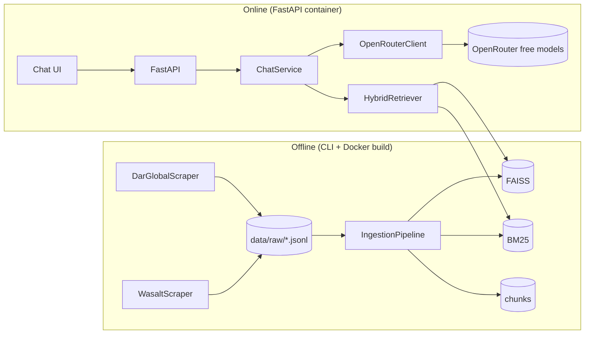

# Dar Assist — DarGlobal & Wasalt Property Assistant

A production-quality RAG chatbot that answers questions about **Dar Global**
(international luxury real-estate developer) and **Wasalt** (Saudi real-estate
platform), grounded exclusively in publicly available data scraped from
[darglobal.co.uk](https://darglobal.co.uk) and [wasalt.sa](https://wasalt.sa/en).

**Live demo:** `<DEPLOY_URL>` · **API docs:** `<DEPLOY_URL>/docs`

> The free hosting tier sleeps when idle — the first load can take ~30 seconds.

## Features

- **Grounded answers with citations** — every fact is cited `[n]` and linked to its
  source page; the bot says so honestly when the data doesn't contain an answer.
- **Hybrid retrieval** — FAISS dense vectors (bge-small-en-v1.5) + BM25 keyword
  search, fused with Reciprocal Rank Fusion so exact project names and semantic
  queries both work.
- **Conversational follow-ups** — "what about in Qatar?" is rewritten into a
  standalone query using the chat history.
- **Token-by-token streaming** over Server-Sent Events.
- **Free-model resilience** — OpenRouter model fallback list, retries with backoff,
  429 handling, answer caching, per-IP rate limiting; on quota exhaustion the bot
  degrades to returning the most relevant source links instead of failing.
- **Polite scraping** — robots.txt compliance, 1 req/s rate limit, identified
  User-Agent, committed data snapshot for reproducible builds.
- **Clean architecture** — protocols + constructor injection, one composition
  root, frozen domain models, 89 tests, `ruff` + `mypy --strict` clean.

## Architecture



See [docs/ARCHITECTURE.md](docs/ARCHITECTURE.md) for the full class diagram,
sequence diagram, error-handling strategy and extensibility notes, and
[docs/DECISIONS.md](docs/DECISIONS.md) for the ADR-style decision log.

## Tech stack

| Concern | Choice |
|---|---|
| Language / runtime | Python 3.12, uv |
| Web framework | FastAPI + Uvicorn, sse-starlette |
| Scraping | Playwright (scrape-time only), selectolax, trafilatura, robots.txt + rate limit |
| Embeddings | fastembed `BAAI/bge-small-en-v1.5` (ONNX, local, 384-dim) |
| Indexes | faiss-cpu (exact cosine) + rank-bm25, RRF fusion |
| LLM | OpenRouter free models with native + client-side fallback |
| Frontend | Vanilla HTML/CSS/JS + marked + DOMPurify |
| Quality | pytest (+respx), ruff, mypy --strict, pre-commit, GitHub Actions |
| Container | Multi-stage Docker on python:3.12-slim, non-root, healthcheck |

## Quick start

### Docker (one command)

```bash
cp .env.example .env   # put your OpenRouter API key in .env
docker compose up --build
# open http://localhost:7860
```

### Local development

```bash
uv sync                               # install deps
cp .env.example .env                  # add OPENROUTER_API_KEY
uv run property-assistant ingest      # build the index from data/raw
make run                              # dev server on :7860
make lint typecheck test              # quality gates
```

To re-scrape the sites (optional — the snapshot is committed):

```bash
uv sync --group scrape && uv run playwright install chromium
uv run property-assistant scrape --site all
```

## How the data was collected

- **Snapshot (19 Nov 2026):** 411 documents → 4,371 chunks.
  DarGlobal: 230 docs (20 projects, 70 press releases, 12 partners, 77
  articles, corporate pages). Wasalt: 181 docs (175 listings across major
  Saudi cities + platform/service pages).
- **Sources:** darglobal.co.uk (projects, press, partners, corporate pages) and
  wasalt.sa English pages (platform/service pages plus a bounded, city-diverse
  sample of listings).
- **Politeness:** robots.txt honoured per host, 1 request/second token bucket,
  page caps per site, English pages only.
- Both sites sit behind bot protection (Incapsula / Cloudflare), so the scrape
  CLI drives headless Chromium via Playwright — scrape-time only, never in the
  runtime image (see ADR 9).
- The raw snapshot is committed in `data/raw/*.jsonl`, so `docker build`
  reproduces the exact same index with **no scraping and no API key**.

## How the RAG pipeline works

1. **Clean:** NFKC normalization, whitespace collapse, boilerplate and
   cross-document repeated lines removed (frequency > 30%).
2. **Chunk:** recursive splitting (paragraph → line → sentence → word) to ~1200
   chars with 200 overlap; every chunk gets a header like
   `[Dar Global | project | AIDA, Muscat / Oman]`.
3. **Index:** L2-normalized bge-small embeddings in a FAISS flat-IP index +
   BM25 over filtered tokens; manifest records model/dim/counts.
4. **Retrieve:** vector and keyword searches run concurrently; rankings merge
   with RRF (k=60); top-6 go to the prompt.
5. **Ground:** if no chunk reaches cosine 0.30, the LLM is skipped and the bot
   answers "not in my data" with suggested questions.
6. **Answer:** numbered context + strict system prompt; inline `[n]` citations
   are mapped back to clickable sources; follow-ups are rewritten first.

## OpenRouter model strategy

Free model IDs rotate, so none are hard-coded in stone: `make free-models`
prints the live list, and `LLM_PRIMARY_MODEL` / `LLM_FALLBACK_MODELS` configure
the chain, which is validated to contain only `:free` IDs. Requests carry the
whole `models` array (OpenRouter native fallback) *and* the client retries the
next model on failure. Quota protections: answer caching, rewrite-only-on-follow-up,
grounding check before any LLM call, per-IP rate limit, and graceful degradation
to source links on 429.

## API

| Method | Path | Description |
|---|---|---|
| GET | `/` | Chat UI |
| GET | `/health` | Liveness |
| GET | `/ready` | Readiness (503 until the index is loaded) |
| POST | `/api/v1/chat` | JSON answer `{session_id?, message}` |
| POST | `/api/v1/chat/stream` | SSE events: `meta`, `token`, `sources`, `done`, `error` |
| DELETE | `/api/v1/sessions/{id}` | Clear a conversation |
| GET | `/api/v1/stats` | Corpus/index statistics |
| GET | `/api/v1/suggestions` | Starter questions |

Interactive docs at `/docs`.

### Smoke test

```bash
curl -s https://<url>/health
curl -s https://<url>/api/v1/stats | jq
curl -s -X POST https://<url>/api/v1/chat -H 'Content-Type: application/json' \
  -d '{"message":"What projects does Dar Global have in Oman?"}' | jq
```

## Testing & evaluation

```bash
make test        # 130 unit + API tests, no network, coverage on src/
make eval        # golden-set retrieval evaluation → docs/EVALUATION.md
```

- **Tests:** 130 passing, **84% coverage** on `src/`; `ruff` and `mypy --strict` clean.
- **Retrieval quality** on the 15-question golden set (full corpus of 411
  documents / 4,371 chunks): **hit@6 = 0.87, MRR = 0.80** — full table in
  [docs/EVALUATION.md](docs/EVALUATION.md).

## Project structure

```
src/property_assistant/
├── main.py            # app factory (create_app)
├── cli.py             # Typer CLI: scrape | ingest | serve
├── container.py       # composition root (DI wiring)
├── core/              # settings, JSON logging, exception hierarchy
├── domain/            # frozen models + enums
├── scraping/          # fetchers, discovery, extractors, scrapers, registry, repository
├── ingestion/         # cleaner, chunker, embedder, FAISS, BM25, pipeline
├── retrieval/         # vector, keyword, hybrid, RRF fusion
├── llm/               # LLMClient protocol, OpenRouterClient, prompts
├── chat/              # guardrails, conversation, rewriter, citations, cache, service
├── api/               # schemas, dependencies, middleware, errors, routers
└── web/               # chat UI (HTML/CSS/JS)
```

## Deployment

Primary: **Hugging Face Spaces** (Docker SDK). The YAML front-matter at the top
of this file configures the Space; set the secret `OPENROUTER_API_KEY` and the
variables `LLM_PRIMARY_MODEL`, `LLM_FALLBACK_MODELS`, `APP_PUBLIC_URL`,
`ENVIRONMENT=prod` in the Space settings, then push this repo to the Space git
remote. Backup: Render.com (Docker runtime, health check `/health`).

## Limitations & future work

- Redis-backed sessions for multi-worker scale (protocol already in place).
- Scheduled re-scraping + index rebuilds (currently a committed snapshot).
- Cross-encoder reranker on top of RRF.
- Arabic embeddings for a bilingual corpus.
- Observability (Langfuse/OpenTelemetry) and auth for the API.
