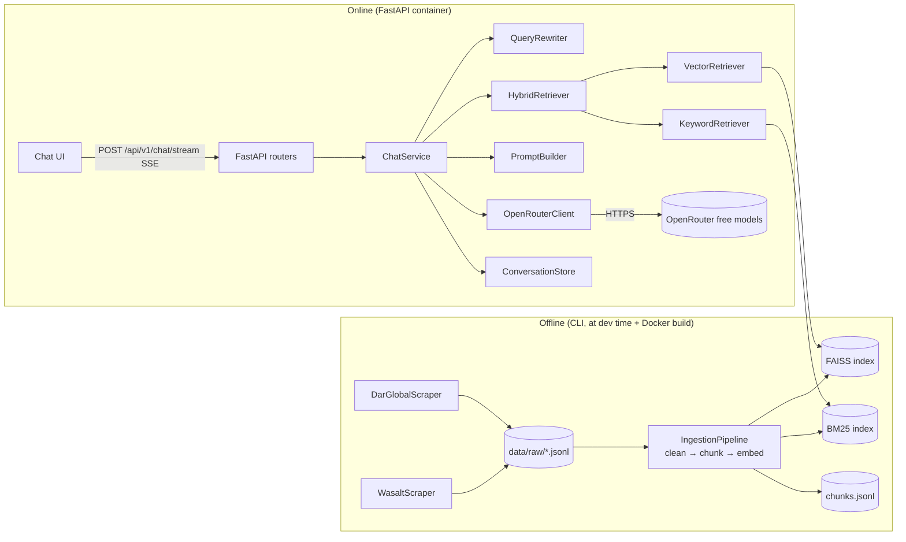
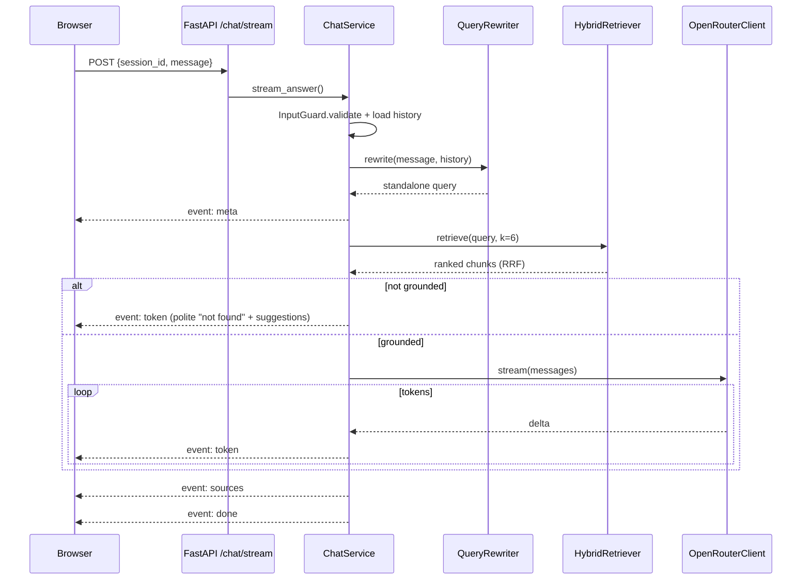

# Architecture

## Overview

Two clearly separated flows: an **offline data pipeline** (scrape → ingest) and an
**online serving path** (API → chat service → retriever + LLM). The offline pipeline
runs at development time and inside the Docker build; the online path is the only
thing that runs in production.

**Request lifecycle:** the UI sends `{session_id, message}` → guardrails validate it →
history is loaded → a follow-up is rewritten into a standalone question (only when
history exists, saving LLM quota) → hybrid retrieval returns the top-k chunks → a
grounded prompt with numbered context is built → the LLM answer streams token by
token → `[n]` markers are mapped back to sources → the turn is saved → `sources`
and `done` events close the stream.

## Design principles

- **SOLID**
  - *S*: one reason to change per class — fetching ≠ extracting ≠ storing.
  - *O*: adding a new site means adding one `BaseScraper` subclass and registering
    it; no other code changes.
  - *L*: any `Retriever` / `LLMClient` / `Embedder` implementation can replace
    another — the orchestration code never knows the difference.
  - *I*: protocols stay small (`Embedder` has three members, not ten).
  - *D*: `ChatService` depends on protocols, never on FAISS or OpenRouter directly.

- **Patterns used (and where)**

  | Pattern | Where |
  |---|---|
  | Template Method | `BaseScraper.run()` fixes the algorithm; subclasses fill in `discover_urls`, `include_url`, `classify`, `prioritise`, `build_metadata` |
  | Strategy | `ContentExtractor`, `Chunker`, `Embedder`, `Retriever`, `LLMClient` |
  | Composite | `CompositeExtractor` merges `NextDataExtractor` + `TrafilaturaExtractor` |
  | Factory / Registry | `ScraperRegistry.create(site)`, `create_app()` app factory |
  | Repository | `DocumentRepository`, `ChunkStore`, `ConversationStore` |
  | Facade / Orchestrator | `ChatService`, `IngestionPipeline` |
  | DI + Composition Root | `AppContainer.build()` wires the whole graph once; FastAPI `Depends` exposes it |
  | Decorator-style retry | tenacity around network calls |

- **Immutability:** domain models are frozen Pydantic models; value types are
  `@dataclass(frozen=True, slots=True)`.
- **Async end to end:** scraping, retrieval and LLM calls are async; CPU-bound
  embedding runs in `asyncio.to_thread`.

## Class diagram

```mermaid
classDiagram
  class BaseScraper {
    <<abstract>>
    +site: SourceSite
    +run() AsyncIterator~Document~
    #discover_urls()* list~str~
    #include_url(url)* bool
    #classify(url, content)* DocType
    #prioritise(urls) list~str~
    #build_metadata(url, content) dict
  }
  BaseScraper <|-- DarGlobalScraper
  BaseScraper <|-- WasaltScraper
  BaseScraper o-- Fetcher
  BaseScraper o-- ContentExtractor
  class Fetcher { <<interface>> +fetch_text(url) FetchResult? }
  Fetcher <|.. HttpFetcher
  Fetcher <|.. BrowserFetcher
  HttpFetcher o-- RateLimiter
  HttpFetcher o-- RobotsPolicy
  class ContentExtractor { <<interface>> +extract(url, html) ExtractedContent? }
  ContentExtractor <|.. NextDataExtractor
  ContentExtractor <|.. TrafilaturaExtractor
  ContentExtractor <|.. CompositeExtractor
  CompositeExtractor o-- ContentExtractor

  class IngestionPipeline { +run() IngestionReport }
  IngestionPipeline o-- DocumentRepository
  IngestionPipeline o-- TextCleaner
  IngestionPipeline o-- Chunker
  IngestionPipeline o-- Embedder
  IngestionPipeline o-- VectorStore
  IngestionPipeline o-- KeywordIndex
  IngestionPipeline o-- ChunkStore

  class Retriever { <<interface>> +retrieve(query, k) list~RetrievedChunk~ }
  Retriever <|.. VectorRetriever
  Retriever <|.. KeywordRetriever
  Retriever <|.. HybridRetriever
  HybridRetriever o-- Retriever

  class LLMClient { <<interface>> +complete(messages) LLMResult +stream(messages) AsyncIterator~StreamChunk~ }
  LLMClient <|.. OpenRouterClient

  class ChatService {
    +answer(session_id, message) Answer
    +stream_answer(session_id, message) AsyncIterator~ChatEvent~
  }
  ChatService o-- InputGuard
  ChatService o-- ConversationStore
  ChatService o-- QueryRewriter
  ChatService o-- Retriever
  ChatService o-- PromptBuilder
  ChatService o-- LLMClient
  ChatService o-- CitationFormatter
  ChatService o-- AnswerCache
```

## Sequence: one streamed chat request

## Error handling strategy

Every application error derives from `AppError`, carrying a machine-readable
`code` and the HTTP status the API maps it to:

| Exception | Status | Behaviour |
|---|---|---|
| `GuardrailViolation` | 400 | invalid input rejected before any downstream work |
| `SessionNotFoundError` | 404 | unknown session id |
| `LLMRateLimitError` | 429 | free-tier quota hit; stream degrades to source links |
| `LLMError` / `LLMUnavailableError` | 502 | all models failed; stream degrades to source links |
| `IndexNotReadyError` | 503 | index not built/loaded; `/ready` also reports 503 |
| `ConfigurationError` | 500 | invalid settings or manifest/model mismatch |

The API returns one consistent envelope:
`{"error": {"code": "...", "message": "...", "request_id": "..."}}`.

The streaming path **never dies silently**: on an LLM failure mid-request, the
client receives an `error` event followed by a fallback answer listing the most
relevant source pages, then `sources` and `done`.

## Grounding & hallucination control

1. Chunks carry a header line `[Site | doc_type | Title, Location]` so the model
   always sees provenance.
2. Retrieval reports each chunk's best vector cosine; if none reaches
   `min_relevance_score` (0.30), the service answers "not in my data" **without
   calling the LLM**.
3. The system prompt forbids answering outside CONTEXT and requires inline `[n]`
   citations; `CitationFormatter` keeps only sources actually cited.
4. Context is data, not instructions (prompt-injection rule in the system prompt).

## Extensibility examples

- **Add a new site:** subclass `BaseScraper` (5 small methods), register it in
  `ScraperRegistry`. Nothing else changes.
- **Swap the vector store:** implement the 5-member `VectorStore` protocol
  (e.g. Qdrant) and construct it in `AppContainer.build()`.
- **Scale sessions beyond one worker:** implement `ConversationStore` over Redis
  and swap it in the container; the service code is unchanged.
- **Swap the LLM provider:** implement `LLMClient`; `ChatService` is unaware of
  OpenRouter.
